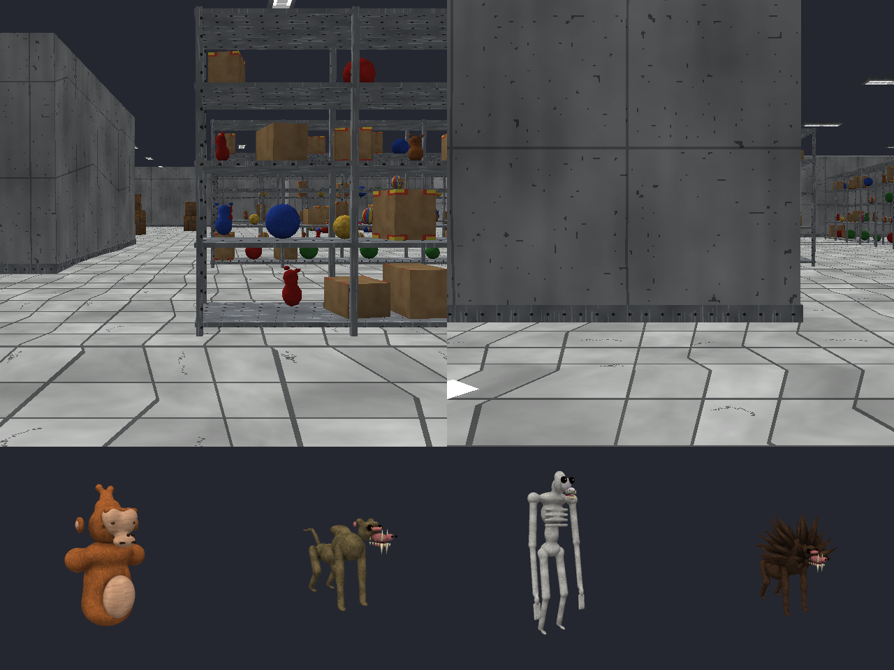

# Babuun Hollow 🐒 (WebXR para Oculus Go)

Jogo de terror em VR que roda **no navegador do Oculus Go** (WebXR), sem instalar nada.
Você é um **macaco sem pernas** e anda só com as mãos (gorilla locomotion acelerada e mais forte).
Fique preso num depósito subterrâneo abandonado (concreto, ladrilhos, luzes fluorescentes, corredores
de prateleiras cheias de brinquedos), pegue as bananas douradas e fuja antes que os babuínos te peguem.

> Jogo original inspirado no gênero "macaco sem pernas + terror". Todos os modelos foram feitos via
> **Blender CLI**, as texturas são procedurais e os sons foram sintetizados do zero.



## Como jogar no Oculus Go
1. Publique a pasta `web/` num endereço **https** (WebXR exige https):
   - **GitHub Pages**: no repositório, *Settings → Pages → Source: GitHub Actions*. O workflow
     `.github/workflows/pages.yml` publica sozinho a cada push.
   - **ou Netlify Drop** (grátis, 1 minuto): abra https://app.netlify.com/drop e arraste a pasta `web/`
     (ou o `BabuunHollow-web.zip` descompactado).
2. No Go, abra o **navegador do Oculus**, entre no endereço e aperte **ENTRAR NO VR**.
3. (Opcional) Antes, toque em **Ativar microfone** para os vídeos da câmera gravarem sua voz.

No PC dá para testar no modo tela: botão **Jogar na tela** (mouse para cima/baixo = braço, botão direito
arrastando = olhar, clique = gatilho, A/D = girar, C/V = câmera, Q = grito, roda = esticar a câmera).

## Controles (um controle só)
| Ação | Como |
|---|---|
| Andar / correr | **Gorilla locomotion real**: a mão gruda onde encosta e o corpo anda ao contrário dela. Empurre o chão para trás **rápido e com força** para ganhar impulso; levante o braço para voltar. |
| Girar | Touchpad **esquerda/direita** |
| Grito de macaco | **Centro** do touchpad (monstros escutam!) |
| Câmera | Touchpad **cima**: pega a câmera / alterna selfie-mundo. **Baixo**: deixa parada no ar (segurar 0,8 s guarda). **Deslizar**: estica o bastão (0,12 a 2,6 m). **Gatilho**: grava/para. |
| Botões do lobby | Toque com qualquer mão **ou** aponte o laser e aperte o gatilho |

Os vídeos (WebM, com sua voz + som do jogo) vão para a pasta **Downloads**.

### Mão duplicada (Go só tem 1 controle)
- **ESPELHO** (padrão): a mão duplicada copia a do controle, espelhada. As duas empurram juntas e você
  **anda reto**. Quando a mão sobe, as duas se aproximam do centro.
- **ALTERNADA**: enquanto a mão do controle empurra, a duplicada vai para o lado **oposto** (frente/cima).
  Quando ela levanta, as duas se juntam.
- Ajustes no lobby: impulso (Normal / Forte / Turbo), ângulo do braço, giro, volume, novo nome.

## O jogo
- **Lobby**:
  - estação de cores com botões R/G/B (0–9) dentro do VR, 8 cores prontas e uma opção aleatória;
  - guarda-roupa com manequim (chapéus, óculos, gravata e cor do acessório);
  - quadro de **14 badges** (toque numa badge para usá-la como título);
  - salas, ajustes, como jogar e suporte da câmera.
- **O Depósito**: pegue as bananas para abrir a porta de aço e fuja.
- **Monstros (com jumpscare)**:
  - **Babuun**: persegue, ouve barulho e salta nas prateleiras;
  - **Pálido**: só anda quando ninguém olha para ele;
  - **Mamãe**: ouve tudo de longe e dá investidas.

## Multiplayer: o seu Go é o servidor
No quadro **SALAS** do lobby:
- **Criar**: nome, **pública** ou **privada**, máximo de jogadores (2 a 10), monstros (Fácil / Normal / Pesadelo),
  bananas (4 / 8 / 12) e **código opcional** (teclado numérico).
- **Pública**: aparece na lista de salas de todo mundo (com `[COD]` se tiver código).
  **Privada**: não aparece; entra digitando o código e apertando **ENTRAR COM CÓDIGO**.
- O óculos que cria a sala **é o servidor**: a partida roda direto entre os óculos (WebRTC, ponto a ponto).
  O serviço público e gratuito do PeerJS é usado só para **apresentar** os jogadores uns aos outros.
- **Troca de host automática**: todos sabem a fila de sucessão.
  - Se o host fecha o jogo, ele avisa e o próximo da fila vira o servidor na hora.
  - Se o host **cai sem avisar**, os outros percebem em ~4 s e o próximo assume.
  - A sala continua com o mesmo nome, código e regras.

## Compilar
```bash
npm install
node tools/genmap.mjs                         # mapa
python3 tools/gen_textures.py                 # texturas procedurais
python3 tools/gen_sounds.py                   # sons sintetizados
blender -b -P tools/blender/build_assets.py   # TODOS os modelos 3D
node tools/build_web.mjs                      # -> web/ (pronto para publicar)
node tools/build_web.mjs --serve              # servidor local em http://localhost:8080
```
`python3 tools/preview_bm.py saida.png app/assets/models/babuun.bm` renderiza qualquer modelo.

## Estrutura
```
src/        código do jogo (three.js + WebXR)
  main.js     WebXR, controle do Go, modo tela    game.js   jogador, locomoção, rodada, monstros, rede
  lobby.js    estações e botões do lobby          camera.js câmera segurável + gravação
  net.js      salas P2P com troca de host         world.js  colisão, raycast, caminhos (BFS)
app/assets/ modelos .bm, texturas, sons, mapa (fontes geradas pelas ferramentas)
tools/      gerador de mapa, texturas, sons, script do Blender, build web
web/        versão pronta para publicar (https)
```
